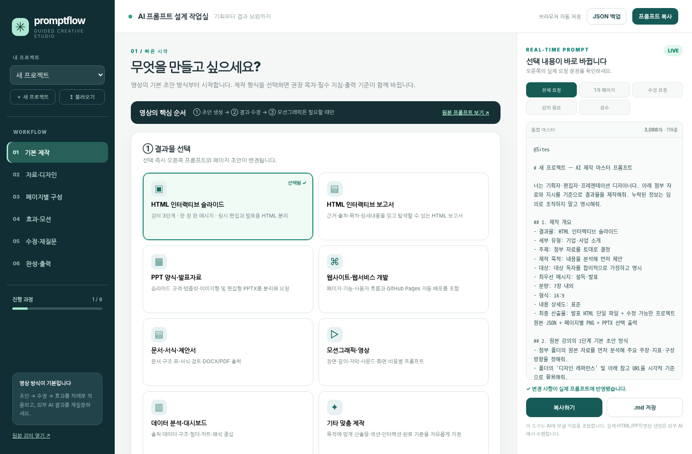
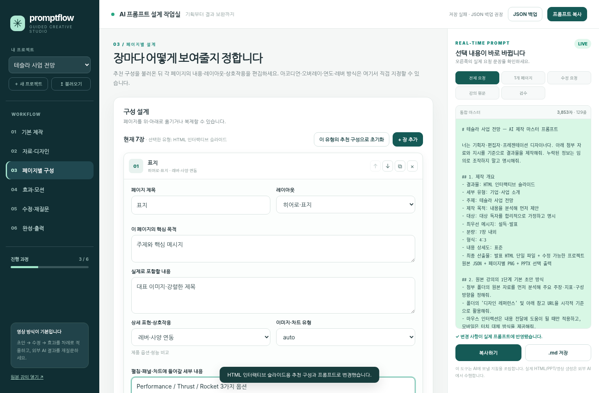

# PromptFlow Studio v3.0 — 영상 3단계 기반 AI 제작 프롬프트 웹서비스

> 무엇을 만들지 고르고 → 필요한 질문에 답하고 → **페이지별로 디자인·상호작용을 지정**하면 → AI에 전달할 **실제 프롬프트가 실시간 변경**되는 GitHub Pages용 웹앱.



서비스: https://ko9ma7.github.io/promptflow-studio/  
저장소: https://github.com/ko9ma7/promptflow-studio

## 꼭 알아두세요

이 웹서비스는 HTML 보고서·PPT·영상이나 웹앱 자체를 **제작하는 AI가 아닙니다**. ChatGPT·Claude 등 외부 AI에 보낼 **제작 지침과 후속 수정 지침을 조립하는 안내 작업실**입니다. 특히 영상 `https://youtu.be/byShnblO4Oc`의 **초안 → 결과 수정 → 모션** 순서를 기본 경로로 삼습니다.

**이전 버전과의 핵심 차이:** 유형·세부 유형·콘텐츠·페이지 UI·고급 효과를 선택할 때 **오른쪽 마스터 프롬프트의 문장이 즉시 달라집니다**. 별도의 생성 버튼 없이 작동하며, 다른 프롬프트 탭을 보고 있으면 관련 변경을 보여주도록 탭이 자동 전환됩니다.

## 1. 1분 사용법

1. `index.html`을 실행하거나 GitHub Pages 주소로 접속합니다.
2. **기본 제작**에서 HTML 슬라이드 / HTML 보고서 / PPT 양식 / 웹서비스 등 결과물 선택. 추천 구성과 결과물 기준이 달라집니다.
3. 주제·대상·목적·장수·규격·제작 AI를 선택합니다. 우측 `전체 요청`이 즉시 변경되는지 확인합니다.
4. **자료·디자인**에서 원문/참고링크/스타일/눈누 폰트/디자인 레퍼런스를 적습니다. 첨부 파일은 **이름만 기록**되므로 외부 AI에는 따로 첨부합니다.
5. **페이지별 구성**에서 한 장씩 제목·실제 내용·이미지/차트·레이아웃과 UI(탭·아코디언·레버·하단 오버레이·연도 연동)를 정합니다. 모든 항목이 프롬프트에 들어갑니다.
6. **효과·모션**에서 필요한 추가 효과만 체크합니다. HTML 상시 편집/비편집 HTML 저장/재불러오기 지침은 기본으로 내장됩니다.
7. 우측 **복사하기**로 외부 AI에 붙여넣고 실행합니다.
8. 받은 결과가 부족하면 **수정·재질문**에서 실제 AI 답변, 문제 위치, 현재/기대 동작을 기록하고 `수정 요청` 프롬프트만 전달합니다.
9. **완성·출력**에서 검수표 점검, Markdown 프롬프트 보관, 프로젝트 JSON 백업/복원을 수행합니다.



## 2. 형식별 핵심 차이

| 선택 | 기본 추천 구성 | 자동 요구 사항 |
| --- | --- | --- |
| HTML 인터랙티브 슬라이드 | 표지→문제→데이터→해결→특징→로드맵→결론 | 편집 상시 내장, 발표용 HTML 분리, 편집 재불러오기, 차트 및 PPTX PNG 선택 출력 |
| HTML 보고서 | 요약→목차→현황→분석→시사점→권고→출처 | 근거·출처·차트·읽기형 레이아웃·인쇄/HTML 저장 |
| PPT 양식 | 표지→배경→숫자→제안→실행→효과→Q&A | 16:9/4:3/16:10, 이미지형 vs 편집 가능 PPTX 요구 명시 |
| GitHub Pages 웹서비스 | 랜딩→작업실→미리보기→사용법→배포 | README, USER_GUIDE, CMD, About, Pages Actions, favicon/OG |
| 문서/영상/분석/기타 | 형식에 맞는 섹션·씬 추천 | 각 출력 포맷·실제 완료 기준에 맞는 요청 |

세부 유형인 **투자·IR 발표, 교육·강의, 시장·산업 분석, 제안서 PPT, SNS 쇼츠, GitHub Pages 웹서비스**를 선택하면 추천 목차도 달라집니다. 이미 페이지를 편집했으면 재설정을 확인합니다.

## 3. 페이지별 UI 프리셋

각 페이지에 `기본형`, `펼침 메뉴`, `하단 오버레이`, `측면 패널`, `중앙 모달`, `탭`, `팝오버`, `레버`, `연도 연동`, `수치 채우기`, `클릭 순차 등장`, `자동 발표`, `호버`, `캐러셀`, `검색·필터` 중 선택합니다. **제목만 프롬프트에 들어가는 것이 아니라 실제 동작 규칙도 들어갑니다.**

예: 3페이지 = `연도 연동`, 세부 내용 = `2023·2024·2025 매출·생산량 연동` 입력 → 최종 프롬프트에 `연도 버튼 선택 시 매출·수치·차트가 같은 연도 데이터로 동시 변경`과 사용자 상세 내용 반영.

## 4. 영상 원본과 편집 방식

- **영상 1단계:** 자료·디자인·분량·폰트·한글 줄바꿈·호버·이미지 생성·Chart.js·참고 효과.
- **영상 2단계:** 글자 크기·장표 추가/삭제/순서·편집·수치 채우기·레버·연도·상세 패널·클릭 등장·자동 발표.
- **영상 3단계:** 15초 영상 제작·중간 및 마지막 삽입·9:16 쇼츠·무음.

영상의 원형 프롬프트는 우측 `강의 원문` 탭, 수정 문구 16개는 **효과·모션 → 강의 수정·모션 원문 레시피**에서 이용합니다. 실제 프롬프트로 넣을 항목은 `고급 효과` 체크를 사용합니다.

**중요:** 제작용 HTML 안에 항상 편집 기능을 넣고, `HTML 저장` 결과물에는 편집 컨트롤이 노출되지 않게 하며, 나중에 제작 화면으로 다시 불러오게 하는 것은 이 앱이 **외부 AI에게 요청하는 제작 요건**입니다. 이 앱이 외부 AI가 만들어 낸 HTML을 직접 수정하거나 PPTX 변환하는 기능은 아닙니다.

## 5. 프롬프트가 정말 변경되는지 확인

- 기본 제작 화면에서 **HTML 슬라이드 → HTML 보고서 → PPT 양식**을 각각 클릭하세요. 우측 `결과물`, `페이지 이름`, `출력 방식`이 달라집니다.
- `주제`에 `테슬라 사업 전망`을 입력하세요. 우측 제목과 주제가 즉시 바뀝니다.
- 페이지별 구성에서 1페이지 `기본형`을 `레버·사양 연동`으로 바꾸세요. **세로 레버 단계 선택 시 사양·이미지·설명 동시 교체** 문장이 생깁니다.
- 효과·모션에서 **연도 연동 차트**를 켜세요. `선택한 고급 효과` 섹션에 한 줄이 추가됩니다.
- 수정·재질문에서 `현재 문제`를 적으세요. 우측 `수정 요청`에 반영됩니다.

재현 테스트에 사용한 자동화 스크립트: `tests/test_dynamic.py` (Playwright 및 Chromium이 설치된 테스트 환경 전용). 브라우저 테스트에서 항목별로 프롬프트가 달라지는지 실제 확인했습니다.

## 6. 자동 저장·백업·파일 취급

- 모든 입력은 현재 브라우저의 LocalStorage에 기록됩니다.
- `JSON 백업`은 프로젝트 구조·작성 자료·지침과 작업 이력을 파일로 저장합니다.
- `불러오기`는 v3 JSON과 일부 이전 v2 프로젝트 구조의 가져오기를 지원합니다.
- 첨부파일은 파일명/용량 메타정보만 저장하며 실제 파일 bytes는 서버로 전송하지 않습니다.
- 민감한 데이터는 브라우저에 입력하지 않는 것을 권장합니다. 공용 PC 사용 후 브라우저 저장 데이터를 관리하세요.
- 브라우저 저장소가 지워지면 자동 저장 데이터도 사라질 수 있으므로 중요한 프로젝트는 JSON 백업이 필요합니다.

## 7. 프로젝트 구조

```text
promptflow-studio/
├─ index.html               # SPA 화면
├─ assets/
│  ├─ app.js                # 상태·프롬프트 생성·화면·내보내기
│  ├─ catalog.js            # 유형/페이지 템플릿/UI/강의 프롬프트 목록
│  ├─ styles.css            # 반응형 스타일
│  ├─ favicon.svg
│  └─ og-preview.svg
├─ tests/test_dynamic.py    # 브라우저 회귀 테스트
├─ docs/                    # 실제 테스트 화면
├─ .github/workflows/deploy.yml
├─ github-bootstrap.cmd     # GitHub 최초 배포·기존 원격 이력 보호
├─ github-update.cmd        # 이후 안전한 업데이트
├─ USER_GUIDE.md            # 메뉴별 사용설명서
├─ CHANGELOG.md
├─ site.webmanifest
├─ 404.html
└─ .nojekyll
```

## 8. 로컬 실행

**간편 실행:** ZIP을 풀고 `index.html`을 더블클릭합니다. JavaScript/LocalStorage가 차단된 환경에서는 브라우저 설정 또는 HTTP 실행이 필요할 수 있습니다.

**권장 HTTP 실행:** 프로젝트 폴더에서 아래 명령을 실행합니다.

```bash
python -m http.server 8000
```

브라우저: `http://localhost:8000/`

npm, 프레임워크 설치, API 키, 별도 DB, 유료 서버가 필요하지 않습니다.

## 9. GitHub Pages 배포: 기존 ko9ma7/promptflow-studio 업데이트

**기존 Git 저장소의 `.git` 폴더는 반드시 유지하세요.** 새 ZIP을 기존 프로젝트 폴더에 풀어 새 파일을 덮어쓰고, 기존 저장소의 이력을 보존합니다. 이전에 별도의 로컬 폴더를 만들었다면 먼저 아래처럼 현재 저장소를 복제해 시작할 수도 있습니다.

```powershell
gh auth login
gh repo clone ko9ma7/promptflow-studio
cd promptflow-studio
# 이후 제공된 프로젝트 파일을 이 폴더로 복사
```

그 후 Windows 10/11에서 `github-update.cmd`를 더블클릭하거나 `github-bootstrap.cmd`를 실행합니다.

스크립트는 `Git`, `GitHub CLI`, 인증, 저장소 존재 여부, origin, main 이력, 새 변경사항을 순서대로 확인하고 **강제 푸시를 사용하지 않습니다**. 원격과 로컬의 이력이 다르면 병합 경로를 확인하며, **완전히 별개 초기 커밋**일 때는 사용자 확인을 받은 후 병합합니다. 변경 충돌을 자동 해결할 수 없으면 중지합니다.

성공 시 About의 `Description / Homepage / Topics`를 갱신하고 GitHub Pages Actions 배포를 확인하려고 시도합니다. **CMD가 실행된 것만으로 웹사이트가 배포 성공한 것으로 간주하지 말고 Actions와 실제 사이트를 확인하세요.**

Repository: https://github.com/ko9ma7/promptflow-studio  
Pages: https://ko9ma7.github.io/promptflow-studio/

GitHub 공식 설정: `Settings → Pages → Build and deployment → Source: GitHub Actions`.

### `fetch first` 오류 대응

`main -> main (fetch first)`는 원격 커밋이 로컬에 없다는 의미입니다. `git push --force`를 사용하면 기존 데이터를 잃을 수 있습니다. 수정 CMD는 `git fetch` 이후 원격·로컬 조상 관계를 판별해 가능한 경우 일반 병합을 시도합니다. 충돌 시 Git 상태를 점검하고 수동 해결해야 합니다.

### CMD 관련 제한

Windows CMD 파일은 Windows 10/11, Git 및 `gh` 설치 환경이 필요합니다. 이 패키지 작성 환경에서는 실제 사용자의 Windows 인증과 GitHub 원격 푸시를 실행하지 않았습니다. 따라서 최종 배포 성공 여부는 GitHub Actions와 실제 브라우저에서 확인해야 합니다.

## 10. GitHub About 설정

스크립트 기본값:

- 이름: `promptflow-studio`
- Description: `Guide AI content creation with real-time prompts, page planning and iterative revisions.`
- Homepage: `https://ko9ma7.github.io/promptflow-studio/`
- Topics: `prompt-builder`, `prompt-engineering`, `github-pages`, `presentation`, `workflow`

다른 저장소로 배포할 때는 `github-bootstrap.cmd` 상단 `OWNER` 및 `REPO_NAME`을 수정하세요.

## 11. 사용자 문서·오류 해결

사용자 안내: [USER_GUIDE.md](USER_GUIDE.md)  
변경 내역: [CHANGELOG.md](CHANGELOG.md)

문제 해결:

| 상황 | 조치 |
|---|---|
| 오른쪽 프롬프트가 바뀌지 않음 | v3 파일이 실제 배포됐는지 확인, 강력 새로고침(Ctrl+F5), Console 오류 확인 |
| 원래 작업을 불러오고 싶음 | JSON 백업 → 불러오기; 첨부 파일은 외부 AI에 다시 첨부 |
| 파일을 직접 AI에 보내고 싶음 | 프롬프트 복사 후 원본 파일을 외부 AI 채팅에 별도 첨부 |
| GitHub push `fetch first` | 최신 `github-update.cmd` 실행, 충돌 시 강제 푸시 금지 |
| Pages 404 | Settings → Pages의 Source, Actions 탭의 deploy.yml 상태 확인 |
| CMD 인증 실패 | `gh auth login`, `gh auth status`, `git config user.name`과 `user.email` 확인 |

## 12. 구현·검증 상태

**구현:** 8개 제작 유형, 6단계 작업 흐름, 타입별 추천 페이지 구성, 페이지별 15종 UI 표현, 7종 고급 효과, 강의 수정 프롬프트 16종, 외부 AI 결과 기반 재질문, JSON 백업, LocalStorage 저장, GitHub 배포 지침, 반응형 UI.

**테스트:** 실제 Chromium DOM 상에서 선택 전후 프롬프트 변화(슬라이드↔보고서↔PPT, 페이지 레버, 연도 효과, 수정 요청) 확인 및 모바일 화면 가로 넘침 확인. CI 또는 실제 GitHub Pages에 대한 E2E는 배포 후 추가 점검이 필요합니다.

**하지 않는 일:** 사용자 GitHub 계정에 자동 로그인/푸시, AI API 호출, 완성된 HTML 보고서 직접 생성, PPTX 직접 변환, 업로드 파일 바이너리 영구 저장.

## 출처와 참고 링크

- 원본 강의: https://youtu.be/byShnblO4Oc
- 디자인: https://kr.pinterest.com/
- 한글 폰트: https://noonnu.cc/
- 차트: https://www.chartjs.org/docs/latest/samples/information.html
- 효과: https://seoul-one-day-many-stories.pegeechmco.chatgpt.site/
- GitHub Pages: https://docs.github.com/en/pages/getting-started-with-github-pages/configuring-a-publishing-source-for-your-github-pages-site
