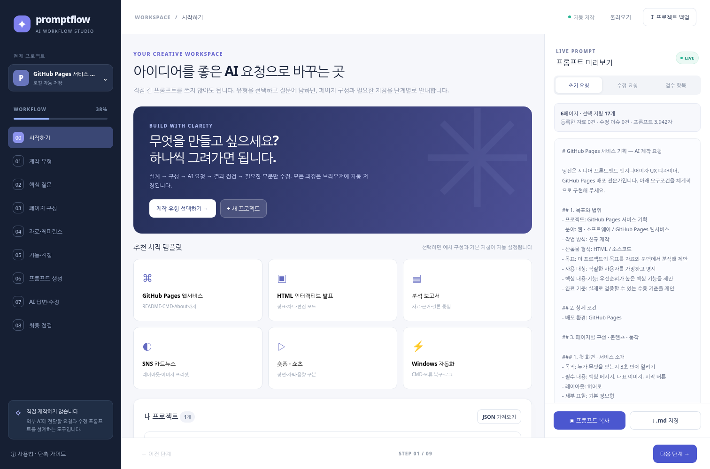

# PromptFlow Studio

> **AI에게 무엇을 어떻게 요청할지 쉽게 설계하고, 답변에서 부족한 부분을 다시 질문하도록 돕는 GitHub Pages 웹서비스.**

PromptFlow는 콘텐츠·앱·슬라이드 자체를 생성하는 AI가 아닙니다. 대분류/세부 유형을 선택한 뒤 목적, 페이지 구성, 상호작용, 레퍼런스, 완성도 기준을 단계별로 정리합니다. 만들어진 **마스터 프롬프트**를 ChatGPT/Claude 등 외부 AI에 전달하고, 그 답변을 붙여넣어 **최소 수정 프롬프트**를 생성합니다.



**기술:** HTML5, CSS3, ES6 JavaScript만 사용하는 완전 정적 웹앱. 서버·계정·API 키·npm 설치가 필요 없습니다. `index.html`과 `assets/`로 동작합니다.

## 1. 첫 실행

1. ZIP 압축을 풀어 `index.html`을 더블클릭하여 엽니다. 일부 브라우저/보안 환경에서는 로컬 저장이 제한될 수 있으므로 아래 로컬 HTTP 실행 방식을 권장합니다.
2. Python이 설치되어 있으면 압축 해제 폴더에서 `python -m http.server 8000`을 실행하고 브라우저에서 `http://localhost:8000`으로 접속합니다.
3. GitHub Pages로 배포하면 웹주소에서 바로 이용할 수 있습니다.

## 2. 주요 기능

| 화면 | 실제로 할 수 있는 일 |
|---|---|
| 시작하기 | 템플릿 선택, 다중 프로젝트 생성/열기/복제/삭제 |
| 제작 유형 | 웹·소프트웨어, 프레젠테이션, 문서, 디자인, 영상, 데이터, 자동화, 직접 정의 및 하위 유형 |
| 핵심 질문 | 목표/대상/기능/완료 기준/유형별 맞춤 조건 입력 |
| 페이지 구성 | 페이지·장표·장면별 제목, 목적, 내용, 레이아웃, 14종 인터랙션 지정; 추가/삭제/복제/순서 변경 |
| 자료·레퍼런스 | URL+사용 목적 등록, 파일 **이름·크기 메타데이터만 기록** |
| 기능·지침 | 품질, 문서화, GitHub Pages, 편집 모드, 상호작용 등 20개 프리셋; 각 항목의 이유·실제 지시문 표시 |
| 프롬프트 생성 | 상세/축약/검수용 자동 조립, 실시간 미리보기, 복사, Markdown 저장, 버전 기록 |
| AI 답변·수정 | AI 답변 붙여넣기, 요청별 검수 상태 지정, 부족한 위치·유형·목표·검증 조건 작성, 재질문 생성, 이력 보관 |
| 최종 점검 | 사용자 검수표, JSON 프로젝트 백업/재불러오기, 프롬프트·수정 요청·검수표 저장 |

**GitHub Pages 웹서비스를 선택하면** 기본적으로 GitHub Pages + Actions, `github-bootstrap.cmd`, `github-update.cmd`, GitHub About(Description/Homepage/Topics), README, USER_GUIDE, CHANGELOG, favicon/OG, 테스트/보안 지침이 켜집니다. 외부 AI에게 이 파일들을 제작하게 하는 **프롬프트**를 생성합니다.

**HTML 인터랙티브 발표를 선택하면** 별도 편집 요청을 반복하지 않도록, AI가 만드는 제작물에 상시 편집 기능과 배포 HTML의 편집 UI 제거, 내보낸 HTML 재불러오기, 차트, 모션을 요청하는 프리셋이 자동 적용됩니다. 본 PromptFlow 서비스가 발표 HTML을 직접 생성하는 것은 아닙니다.

## 3. 대표 사용 예시

**목표:** AI에게 온라인 상품 설명 사이트 제작을 요청했는데, 모바일 메뉴와 GitHub Pages CMD가 누락됨.

1. 시작 → `웹·소프트웨어` / `GitHub Pages 웹서비스` 선택.
2. 핵심 질문에 사이트 목적, 사용자, 3대 기능, 성공 기준 입력.
3. 페이지 구성에서 `첫 화면 / 기능 소개 / 설명 / 문의` 등으로 편집. 상세보기에는 `하단 시트` 또는 `측면 드로어` 선택. 트리거·콘텐츠·닫기 동작도 직접 기록.
4. 자료 탭에서 참고 링크나 파일 이름을 추가.
5. `기능·지침`에서 GitHub About, CMD, README 등 확인.
6. `프롬프트 생성 → 복사`한 내용을 ChatGPT/Claude에 붙여넣고 실제 첨부 파일도 따로 전달.
7. AI 결과가 오면 `AI 답변·수정`에 붙여넣음. `GitHub 배포 누락` / `모바일 반응형`을 미흡으로 지정하고 정확한 현상, 기대 결과를 입력.
8. `수정 요청 복사`로 이전 AI 대화에 추가. 잘된 부분은 유지하도록 자동 요청됨.
9. 수정이 반복되면 이력으로 보관하고 최종 단계에서 프로젝트 JSON을 다운로드.

더 자세한 메뉴별 사용법: **[USER_GUIDE.md](USER_GUIDE.md)**

## 4. 데이터 저장·백업·보안

- 브라우저 `localStorage`에 사용자 입력, 페이지 구성, URL/파일명, AI 답변/수정 이력 및 설정을 자동 저장합니다.
- 브라우저 데이터/사이트 저장소를 삭제하거나 다른 PC/브라우저를 사용하면 자동 동기화되지 않습니다. **반드시 '프로젝트 백업'에서 JSON을 저장**하세요.
- 파일은 이름과 크기, 사용 목적만 기록합니다. 파일 원문/바이너리를 서버에 업로드하거나 자동으로 AI에 전달하지 않습니다.
- JSON 백업에는 브리프, AI 답변, URL 등 사용자가 입력한 텍스트가 포함됩니다. 민감정보를 포함했다면 공유하지 마세요.
- AI의 결과는 직접 입력하고 수동 검수합니다. AI API 연결/자동 답변 판정/코드 실행/실제 배포 검증 기능은 없습니다.
- 사용자가 입력한 내용은 이 사이트의 서버로 전송하지 않습니다. 단, 상단에 포함된 외부 웹폰트는 인터넷 연결 환경에서 폰트 제공자로 요청될 수 있습니다. 오프라인에서는 시스템 폰트를 사용합니다.
- 프로젝트 JSON은 자신이 신뢰하는 파일만 불러오세요. 가져올 때 타입·구조를 검사하고 브라우저에서 표시되는 문자열은 HTML 이스케이프 처리합니다.

## 5. GitHub Pages에 최초 배포 (Windows)

### 준비

- [Git](https://git-scm.com/downloads) 설치
- [GitHub CLI (`gh`)](https://cli.github.com/) 설치
- GitHub 계정 및 권한 보유
- 설치 확인: CMD 또는 PowerShell에서 `git --version`, `gh --version`
- Git 사용자 설정(최초 1회):

```cmd
git config --global user.name "Your Name"
git config --global user.email "you@example.com"
gh auth login
```

### 원클릭 초기 업로드

압축 해제 폴더에서 `github-bootstrap.cmd`를 실행하세요. **필요하면 파일 상단 `REPO_NAME=promptflow-studio`를 원하는 영문 저장소 이름으로 수정**합니다.

스크립트는 다음을 실행합니다.

1. Git/gh/로그인/계정/필수 파일 확인
2. GitHub 사용자 이름 확인 및 저장소 생성 (이미 있으면 재사용)
3. Git 초기화와 원격 origin 검증 (다른 저장소에 연결되어 있으면 안전 중단)
4. 변경된 파일만 커밋하고 `main`을 원격에 푸시 (강제 푸시 금지)
5. GitHub Repository **About**: 프로젝트 설명, Homepage(예상 주소), Topics 등록
6. GitHub Pages의 Build source를 Actions로 설정 시도
7. 최근 Actions 실행 내역 및 예상 사이트 URL 안내

**성공적으로 푸시했다고 배포가 끝난 것은 아닙니다.** GitHub 저장소 → **Actions**에서 `Publish PromptFlow to GitHub Pages` 실행이 성공했는지, **Settings → Pages**에서 Source가 **GitHub Actions**인지 확인하세요. 그 뒤 `https://<GITHUB_USER>.github.io/<REPO_NAME>/`에서 접속되는지 직접 테스트합니다.

About Homepage는 배포되기 전에 계산한 **예상 URL**입니다. 도메인·사용자 저장소 종류가 달라 실제 URL이 다르면 About을 수정해야 합니다.

### 이후 업데이트

파일을 수정하고 `github-update.cmd`를 실행합니다.

- 변경사항이 있으면 커밋 → `git push origin main` 실행
- 변경사항이 없으면 불필요한 커밋 생략
- 원격 이력이 앞서 있으면 강제 푸시하지 않고 중단/안내
- Actions가 완료되어 실제 사이트가 갱신되었는지 별도 확인

원하는 커밋 메시지로 실행하려면 CMD에서 `github-update.cmd "fix: improve prompt flow"` 형식을 사용할 수 있습니다.

### GitHub Social Preview

프로젝트에 `assets/og-preview.png`(1200×630)와 편집 가능한 SVG 원본이 포함되어 있습니다. 공개용 사용 시 사이트의 `og:image` 주소를 배포된 **절대 HTTPS URL**로 지정하는 것을 권장합니다. GitHub Repository 자체의 Social Preview는 **Settings → General → Social preview**에서 별도 업로드합니다. CMD/CLI로 Social Preview까지 자동 설정했다고 주장하지 않습니다.

## 6. 폴더 구조

```text
promptflow_web/
├─ index.html                 # 웹서비스 화면
├─ assets/
│  ├─ app.js                  # 질문·프롬프트·검수·저장 로직
│  ├─ styles.css              # 반응형 디자인
│  ├─ favicon.svg
│  └─ og-preview.svg
├─ site.webmanifest
├─ 404.html
├─ .nojekyll
├─ .gitignore
├─ .github/workflows/deploy.yml
├─ github-bootstrap.cmd      # Windows 최초 업로드
├─ github-update.cmd         # Windows 변경 업로드
├─ README.md
├─ USER_GUIDE.md
└─ CHANGELOG.md
```

GitHub Actions는 HTML/CSS/JS와 웹 자산을 `dist/`에 복사해 Pages로 배포합니다. **npm install, Vite base 경로, node_modules가 불필요**한 순수 정적 구조입니다. 추후 React/Vite로 전환한다면 `base`와 Actions 빌드 산출물 경로를 새로 맞춰야 합니다.

## 7. 오류·문제 해결

| 상황 | 원인과 해결 |
|---|---|
| 입력 내용이 저장되지 않음 | 로컬 파일/시크릿 모드/브라우저 정책에서 저장 제한 가능. HTTP에서 실행하고 JSON을 백업하세요. |
| 프롬프트 복사가 안 됨 | 일부 비보안 환경에서 클립보드 API 제한. `.md 저장` 후 해당 파일을 열어 복사하세요. |
| 첨부 파일이 AI에 보이지 않음 | PromptFlow는 파일명·크기만 기록. 실제 파일을 외부 AI 창에 다시 첨부해야 합니다. |
| CMD가 실행되지 않음 | Windows PC에서 실행해야 하며 Git, gh 설치 및 인증 확인이 필요합니다. |
| `git push` 충돌 | 다른 PC/웹에서 먼저 수정했을 수 있음. `git fetch`로 상황 확인 후 수동 병합하고 재실행. `--force` 금지. |
| About 설정 실패 | 저장소 권한, gh 로그인, URL 확인. `gh repo edit`를 수동 실행할 수 있습니다. |
| GitHub Pages 404 | Actions 실행 성공, Settings → Pages Source, 배포 URL의 정확한 Repository명 확인. |
| README만 있고 웹이 안 뜸 | GitHub Pages는 `index.html` 포함 정적 파일이 필요. ZIP 전체 내용과 workflow 파일이 업로드되었는지 확인. |
| 저장된 데이터를 다른 기기에서 못 봄 | 계정 동기화가 없음. JSON 백업 → 새 기기에서 `불러오기`로 복원. |

## 8. 현재 지원 범위와 한계

**동작:** 8개 유형, 구성 페이지·상호작용 선택, 실시간 프롬프트 조립, 프롬프트 다운로드, 수동 AI 응답 검토, 수정 요청·버전 기록, JSON 백업·복원, GitHub Pages 배포 자동화 스크립트/문서.

**동작하지 않음:** 외부 AI의 자동 답변 수신, 코드 실행/검증, 사용자 계정/클라우드 동기화, 첨부 파일 본문 추출·자동 업로드, GitHub 배포를 브라우저에서 직접 실행, PPT/HTML/영상 콘텐츠 실제 생성.

## 9. 라이선스 및 공개 범위

이 샘플 소스는 사용자가 개인/팀 프로젝트에 복사·개선하여 사용할 수 있도록 제공된 시작점입니다. 제3자 라이브러리 및 웹폰트에는 해당 권리자의 조건이 적용됩니다. 공개 저장소에서는 기밀 자료·API 키·개인용 프로젝트 JSON을 커밋하지 마세요.

### 공식 참고

- [GitHub CLI repo create](https://cli.github.com/manual/gh_repo_create)
- [GitHub CLI repo edit](https://cli.github.com/manual/gh_repo_edit)
- [GitHub Pages Action 배포](https://docs.github.com/en/pages/getting-started-with-github-pages/using-custom-workflows-with-github-pages)
- [GitHub Pages REST API](https://docs.github.com/en/rest/pages/pages)
